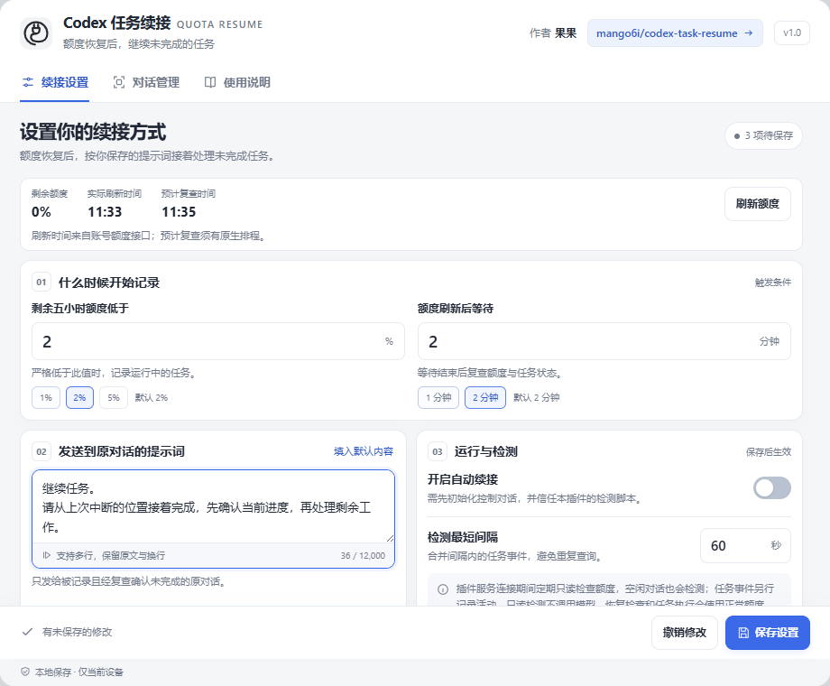
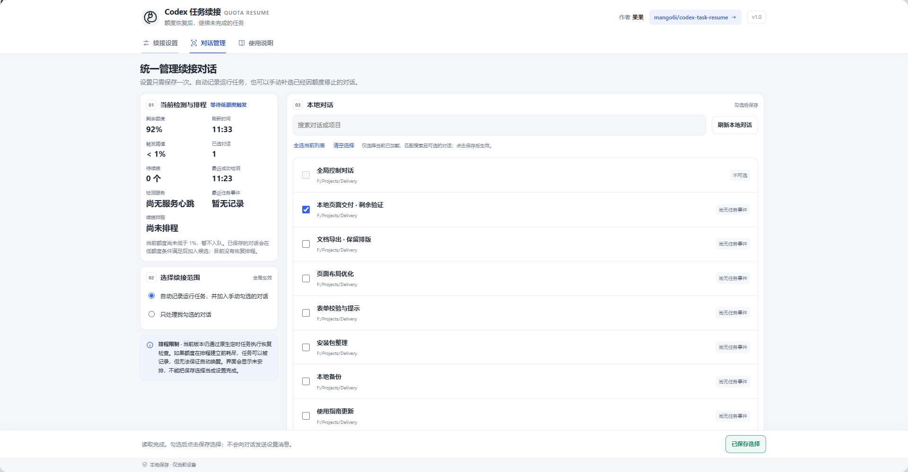
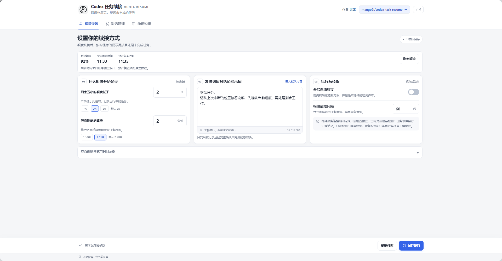
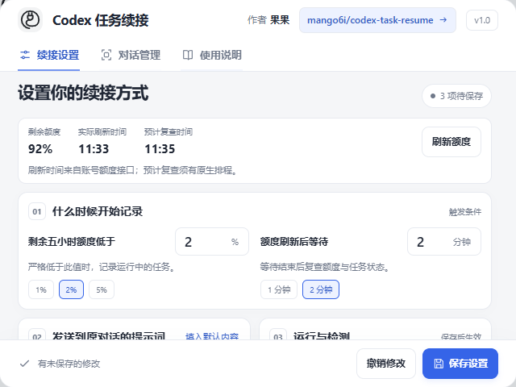
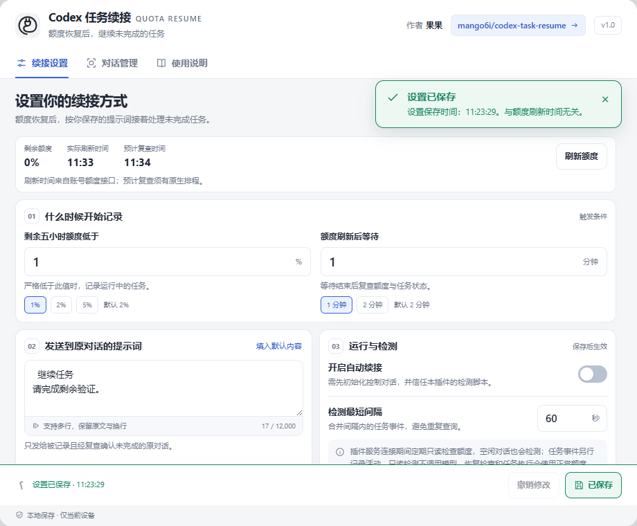
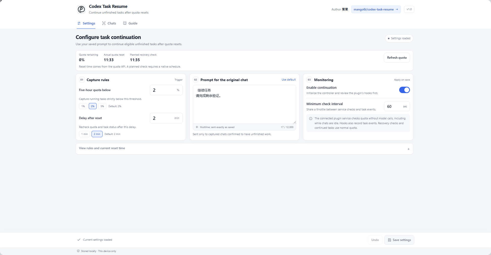
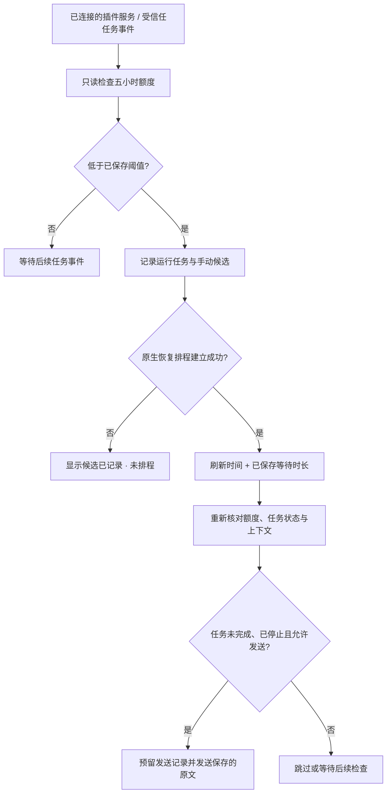

# Codex 任务续接

<p align="center">
  <a href="README_EN.md"><kbd>English</kbd></a>
  &nbsp;|&nbsp;
  <a href="README.md"><kbd>中文</kbd></a>
</p>

<div align="center">
  
  <h1>Codex 任务续接</h1>
  <p>统一管理低额度时的未完成任务，在成功安排的恢复检查中继续原对话。</p>
  <p><b>Windows · 本地 Codex / ChatGPT Work · 自动中英文界面 · 自定义提示词</b></p>
  <p>
    <a href="https://github.com/mango6i/codex-task-resume/releases/tag/v1.0.0">下载安装包</a> ·
    <a href="docs/INSTALL.md">安装与使用指南</a> ·
    <a href="#界面预览">界面预览</a> ·
    <a href="https://github.com/mango6i/codex-task-resume/issues">反馈问题</a>
  </p>
  <p>版本 <b>1.0 · 预览版</b>（清单 1.0.0） · 作者 <a href="https://github.com/mango6i">果果</a> · <a href="LICENSE">MIT 开源协议</a></p>
</div>

> **当前版本的关键限制**
>
> 恢复检查仍需要通过原生模型回合建立排程。如果五小时额度已经耗尽，而且此前没有成功建立排程，本版不能保证在额度刷新后自行唤醒。保存参数、勾选对话或打开开关，都不等于排程已经建立。完整的“额度耗尽后无需模型建立排程”机制尚未实现，真实恢复发送完整周期仍待验证。

## 适合什么场景

你在本地 Codex 或 ChatGPT Work 同时处理多个任务，希望集中设置续接规则，避免每个对话都重复发送设置指令。

在一个面板中设置剩余额度阈值、刷新后等待时间和续接提示词；插件服务连接期间定期只读检测额度，任务事件记录活动；低于阈值时记录运行任务，也允许手动选择已因额度停止的本地对话。成功建立原生恢复排程后，再检查额度和任务上下文，向符合条件的原对话发送保存的提示词。

这是果果维护的第三方本地插件，适用于支持相关插件、Hook、MCP 设置和原生定时工具的客户端环境。

## 界面预览

以下截图来自隔离测试环境，对话标题、额度和时间均为示例。

### 续接设置

设置集中保存一次。支持多行提示词、阈值快捷值、显式开关和撤销；保存后显示绿色确认及明确标注的保存时间；上方另列实际五小时额度刷新时间和预计复查时间。



### 对话管理

宽屏采用左侧状态与范围、右侧本地列表的布局。可以搜索、刷新、全选当前可选列表和清空选择；记录候选后仍需安排恢复检查，并在发送前核验任务。



<details>
<summary>查看宽屏设置、小窗口与保存成功提示</summary>

宽屏的内容区最多 1320 像素，设置分三栏；小窗口合并布局，中间内容滚动，保存按钮保持可见。







</details>

## 功能与当前状态

| 功能 | 当前行为 |
| --- | --- |
| 全局参数设置 | 修改阈值、等待时间、多行提示词和检测最短间隔，无需逐个对话设置 |
| 本地对话管理 | 只读加载根对话的标题和项目路径，支持搜索与手动勾选 |
| 两种目标范围 | 自动记录运行任务并加入手动选择；或仅处理勾选的对话 |
| 低额度检测 | 插件服务连接期间定期只读查询，任务事件共用节流；不使用模型每分钟轮询 |
| 实际刷新时间 | 自动读取账号接口的 300 分钟窗口，按实际刷新时间加等待时长计算预计复查 |
| 候选与发送记录 | 持久化队列、排除项和发送记录，保留升级前的数据 |
| 恢复检查 | **需要成功建立原生排程**；目前建立排程需要模型回合，应在额度耗尽前提前建立 |
| 发送前复查 | 要求额度恢复、等待时间已到，且任务未完成并已停止 |
| 防重复 | 发送前持久化预留；发送结果不确定时不自动重试 |

### 会跳过哪些任务

仍在运行、已完成、手动暂停、等待输入或批准、归档、控制对话、子代理、远程 / 云端任务，以及无法明确判断状态的对话。勾选只保存允许处理的范围，不是“立即向这个对话发消息”。

## 下载安装

1. 从 [Releases](https://github.com/mango6i/codex-task-resume/releases/tag/v1.0.0) 下载 **codex-task-resume-1.0.zip**。不要把 GitHub 自动生成的源码 ZIP 当作发行安装包。
2. 解压到普通本地目录，确认已有 **Python 3.10+** 和 **Codex CLI**。
3. 完全退出客户端，双击解压目录中的 **install.cmd**，等待安装成功，再重新打开客户端。
4. 在插件详情的 **设置 → 统一管理** 中打开 **管理 Codex 任务续接**；也可使用客户端应用入口 **Codex 任务续接 · 管理**。

**这个 ZIP 使用本地安装器，不要上传到“创建插件”的 ZIP 上传窗口。**

安装不会自动开启监控，也不会代替客户端的脚本信任审核。已有用户设置、控制对话关联、勾选范围、队列和发送记录会保留；安装失败时保留 / 恢复旧安装，不清理其他插件或公共缓存。

### 让 GPT 帮你安装

把发行 ZIP 附给能访问本机文件的本地 Codex / ChatGPT Work，或提供下载路径，然后使用[可复制的安装提示词](docs/INSTALL_WITH_CODEX.md)。助手按包内安装器执行，保留用户设置；需要重启或审核脚本时会说明。普通 ChatGPT 网页无法安装本机插件。

### 首次使用

只需在一个保留的本地控制对话中初始化一次：

```text
使用 $quota-resume 初始化设置，保留我已保存的参数，暂不开启自动续接。
```

随后按客户端原生提示审核并信任本插件的 Hook，进入设置填写参数，显式开启开关并点击保存；在额度仍可用时，通过控制对话提前建立原生恢复检查。日常修改参数和选择目标直接在面板完成，首次初始化也不需要每个目标对话各发一遍。

详细步骤、参数解释、停止方式和故障排查见 [安装与使用指南](docs/INSTALL.md)。

## 参数说明

| 参数 | 新配置默认值 | 含义 |
| --- | --- | --- |
| 剩余额度阈值 | 2% | 剩余五小时额度**严格低于**这个值才开始记录候选，范围 0.01–99% |
| 刷新后等待 | 2 分钟 | 在实际刷新时间之后等待，再安排恢复复查，范围 1–60 分钟 |
| 续接提示词 | `继续任务` | 保存的原文发送到符合条件的原对话，支持换行 |
| 检测最短间隔 | 60 秒 | 插件服务连接期间的额度查询间隔，与任务事件共用节流 |
| 自动续接开关 | 关闭 | 初始化及信任审核后，由用户明确开启 |

已有自定义参数优先，升级不会把它们重置为默认值。

例如：阈值 2%，实际刷新时间 19:13，等待 2 分钟，目标复查时间约为 19:15。这个时间要以成功建立的排程为前提，并受设备、客户端和可用额度影响。绿色提示中的“设置保存时间”与额度刷新时间分别显示。

## 界面语言

沿用 [iOSAppDownloader](https://github.com/mango6i/iOSAppDownloader) 的说明格式：中文 `README.md` 与对应英文 `README_EN.md` 分开维护，顶部用 English / 中文按钮互相切换，章节和图片对应。

设置面板、入口、使用说明、操作提示及原生设置字段自动读取 Windows **显示语言**：中文语言变体显示简体中文，其他语言显示英文。系统语言改变后重新打开面板即可；插件详情说明按安装时的系统语言生成。你的对话标题、项目路径、已保存提示词及换行不会自动翻译或修改。



## 工作流程



界面会区分“等待低额度触发”“候选已记录 · 未排程”和“存在排程记录 · 待核验”，不会把保存成功包装成自动续接已经完成设置。

## 支持范围与数据

| 环境 | 支持情况 |
| --- | --- |
| Windows 本机的本地 Codex 根对话 | 支持，取决于客户端原生工具与 Hook 能力 |
| 本地 ChatGPT Work 执行的 Codex 类型对话 | 支持，使用相同的本地能力 |
| 普通 ChatGPT 网页对话 | 不支持 |
| 云端 Work、远程主机、子代理 | 不支持 |

检测只读查询不调用模型；建立排程、恢复检查、判断上下文和继续执行任务仍会使用正常额度。插件 MCP 服务连接期间会进行本地检测；服务断开、客户端退出、设备休眠或额度不足可能导致停止或延后。

偏好与运行状态保存在 `%LOCALAPPDATA%/SkillHubQuotaResume/`。内部插件身份和数据目录沿用旧名称，以保留已有安装。发行包与源码不包含用户的实际设置、账号关联、任务队列或对话记录。

## 从源码构建与验证

运行行为测试：

```powershell
python -m unittest discover -s tests -v
```

构建当前版本的发行包：

```powershell
python scripts/build_release.py
```

构建器检查清单、资源、Hook 可移植性、文件边界和 ZIP 完整性，输出 `dist/codex-task-resume-1.0.zip` 及校验文件。安装时会根据当前机器的 Python 路径生成实际 Hook 命令。

```text
.codex-plugin/plugin.json     插件清单，安装身份保持兼容
.mcp.json                    本地设置服务配置
hooks/                       事件检测定义
server/                      MCP 设置与本地对话列表服务
ui/                          设置面板和入口界面
skills/quota-resume/          续接编排、状态、队列及发送记录
assets/                      图标与隔离环境截图
tests/                       行为验证
scripts/build_release.py     发行包构建器
docs/                        安装指南、验证范围和版本说明
install.cmd / install.ps1    Windows 安装器
```

验证范围见 [验证说明](docs/VERIFICATION.md)。真实额度耗尽、刷新、原生唤醒和发送的完整周期仍未完成验收。

## 反馈与开源协议

请在 [Issues](https://github.com/mango6i/codex-task-resume/issues) 描述客户端版本、复现步骤和界面提示；分享截图前请自行遮住私人对话、路径及账号信息。

本项目采用 [MIT License](LICENSE)，作者 [果果](https://github.com/mango6i)。
