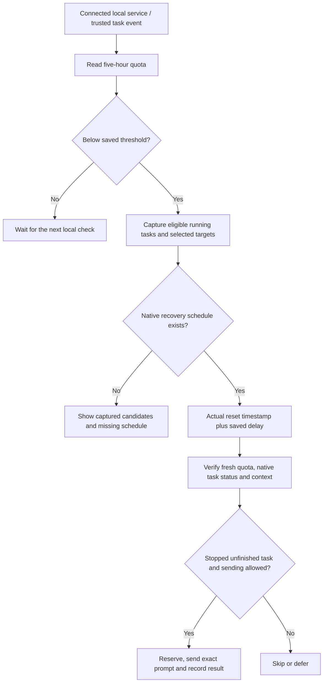

# Codex Task Resume

<p align="center">
  <a href="README_EN.md"><kbd>English</kbd></a>
  &nbsp;|&nbsp;
  <a href="README.md"><kbd>中文</kbd></a>
</p>

<p align="center"></p>

**Manage unfinished local Codex / ChatGPT Work tasks and continue eligible chats after quota resets.**

Windows · Local plugin · Automatic Chinese / English UI · Custom continuation prompt

[Release downloads](https://github.com/mango6i/codex-task-resume/releases/tag/v1.0.0) · [Installation guide (Chinese)](docs/INSTALL.md) · [Screenshots](#screenshots) · [Report an issue](https://github.com/mango6i/codex-task-resume/issues)

Version **1.0 · Preview** (manifest 1.0.0) · Author [果果](https://github.com/mango6i) · [MIT License](LICENSE)

> [!IMPORTANT]
> **Current limitation:** local quota monitoring and candidate capture do not themselves schedule a model turn. A native recovery check must be successfully scheduled in advance. If quota runs out before that happens, this version cannot guarantee an automatic wake. A complete real-world exhaustion → reset → native wake → continuation cycle has not yet been verified. Saving settings or selecting chats alone does not complete setup.

## When to use it

You have multiple local Codex or ChatGPT Work tasks and want one place to configure continuation, instead of sending setup instructions in every chat.

Set a quota threshold, a delay after reset and an exact prompt. While the native plugin service is connected, a local worker queries quota without model inference, even when chats are idle. Trusted hooks record task events. At low quota, the plugin captures running tasks and manually selected chats. A previously scheduled native check then verifies quota, task state and recent context before sending the saved prompt to eligible original chats.

This is a third-party local plugin maintained by 果果. It depends on the client's native plugin, MCP, hook, thread-management and scheduling capabilities.

## Screenshots

Screenshots come from isolated tests. Chat titles, quota values and timestamps are examples.

### Continuation settings

Save settings once. The panel supports multiline prompts, presets, an explicit enable switch and undo. A green confirmation identifies the settings save time separately from the actual quota reset time.


### Chat management

On wide screens, monitoring and scope appear beside the local chat list. Search, refresh, select visible eligible chats or clear the selection. Save to apply. Saved target count, queued candidates, recent checks and schedule records are separate facts.


<details>
<summary>Wide settings, small window and save confirmation</summary>

Content is centered with a maximum width of 1320 px. Wide settings use three columns; small windows stack the sections and retain visible save controls.


</details>

## Features and current status

| Feature | Current behavior |
| --- | --- |
| Global settings | Threshold, reset delay, multiline prompt and minimum check interval |
| Local chat management | Read chat titles and project paths; search, select visible eligible targets and clear selections |
| Two scopes | Running tasks plus selected chats, or selected chats only |
| Quota monitoring | A local worker while the MCP service is connected; shared throttling with hooks; no minute-by-minute model polling |
| Current reset time | Read the actual 300-minute quota window from the account API; compute the planned check from its reset timestamp |
| Candidates and send records | Persist candidates, exclusions and send reservations across updates |
| Recovery check | **Requires a native schedule created through a model turn**, preferably before quota exhaustion |
| Pre-send validation | Confirm elapsed delay, quota recovery and a stopped task with affirmative evidence of unfinished work |
| Duplicate protection | Persist a reservation before sending; never automatically retry uncertain results |

### Tasks that are skipped

Running, completed, manually paused, waiting for input or approval, archived, controller, subagent, remote/cloud and ambiguous tasks. Selecting a chat permits candidate capture; it does not immediately send a message or prove that work is unfinished.

## Download and install

1. Download **codex-task-resume-1.0.zip** from [Releases](https://github.com/mango6i/codex-task-resume/releases/tag/v1.0.0). GitHub's automatically generated source archive is separate from the release package.
2. Extract it into a normal local folder. Install **Python 3.10+** and **Codex CLI** first.
3. Fully exit the desktop client, run **install.cmd**, wait for success, and reopen the client.
4. In plugin details, open **Settings → Management → Manage Codex Task Resume**, or use the global **Codex Task Resume · Manage** entry. Chinese systems display the corresponding Chinese labels.

**Use the local installer. Do not upload this ZIP into the Create Plugin upload dialog.**

Installation does not enable monitoring or grant hook trust. Updates preserve existing settings, controller ownership, selected scope, candidates and send records. Failed installation retains or restores the previous installation; unrelated plugins and shared caches are preserved.

### Install with a local assistant

Attach the release ZIP, or provide its local path, to a local Codex / ChatGPT Work chat with file access. Use the [copyable installation prompt](docs/INSTALL_WITH_CODEX.md#english). The assistant follows the bundled installer, preserves user settings and explains any required restart or hook review. Ordinary ChatGPT web cannot install local plugins.

### First use

Initialize once in one retained local controller chat:

```text
Use $quota-resume to initialize settings, preserve my saved values and leave continuation disabled.
```

Review and trust the plugin's hooks through the native client. Configure the settings, explicitly enable continuation, save, and establish a native recovery check in the controller while quota remains available. Normal settings edits and selection changes use the panel; target chats do not each need a setup message.

See the [installation guide (Chinese)](docs/INSTALL.md) for detailed steps, stopping and troubleshooting. The in-plugin Guide follows the detected system language.

## Settings

| Setting | New configuration default | Meaning |
| --- | --- | --- |
| Quota threshold | 2% | Capture candidates when remaining five-hour quota is **strictly below** this value; 0.01–99% |
| Delay after reset | 2 minutes | Wait after the actual reset timestamp before checking; 1–60 minutes |
| Continuation prompt | `继续任务` | Send the saved text exactly, including newlines; the English Use default button inserts `Continue task` only when clicked |
| Minimum check interval | 60 seconds | Shared throttle for local service and task-event quota queries |
| Enable continuation | Off | Explicit user activation after initialization and hook review |

Existing custom values take precedence. Updates and language detection never reset or translate saved prompts.

For example, an actual reset at 19:13 with a 2-minute delay gives a planned check at 19:15. This requires a successful native schedule and an available client, device and account quota. The time shown in the green save confirmation is the settings save time, not the reset time.

## Language

The project follows [iOSAppDownloader](https://github.com/mango6i/iOSAppDownloader)'s documentation layout: Chinese `README.md`, matching English `README_EN.md`, and English / 中文 links at the top.

The settings panel, launcher, help, feedback and native settings metadata automatically use the Windows **display language**: Chinese language variants use Simplified Chinese; other languages use English. Reopen the panel after changing the system language. Installation localizes the plugin detail description to the display language at installation time. Chat titles, project paths and saved prompts remain unchanged.

## Workflow



The panel distinguishes saved selections, queued candidates, connected service, recent event evidence and schedule records. A recorded ended turn does not prove that a task is complete. A schedule record does not prove that the client will successfully execute it.

## Compatibility and data

| Environment | Support |
| --- | --- |
| Local root Codex chats on Windows | Supported subject to native client capabilities |
| Local Codex-backed ChatGPT Work chats | Uses the same local capabilities |
| Ordinary ChatGPT web chats | Unsupported |
| Cloud Work, remote hosts and subagents | Unsupported |

Local settings and quota queries do not call the model. Scheduling, recovery context checks and continued work use normal quota. Monitoring stops when the MCP connection closes. An exited client, sleeping device, disconnected service or exhausted quota can delay or prevent execution.

Preferences and state remain under `%LOCALAPPDATA%/SkillHubQuotaResume/`. The legacy internal plugin identity and data folder are retained for compatibility. Source and release packages exclude user settings, account associations, task queues and chat records.

## Build and verification

```powershell
python -m unittest discover -s tests -v
python scripts/build_release.py
```

The builder validates metadata, resources, portable hook commands, filesystem boundaries and ZIP integrity. It outputs `dist/codex-task-resume-1.0.zip` and `SHA256SUMS.txt`. The installer adapts hook commands to the machine's actual Python path.

```text
.codex-plugin/plugin.json     Plugin identity and metadata
.mcp.json                    Local settings service
hooks/                       Lifecycle event hooks
server/                      MCP, connected monitoring and language detection
ui/                          Settings, launcher and translation dictionary
skills/quota-resume/          Orchestration, durable state and send reservations
assets/                      Icon and isolated test screenshots
tests/                       Behavior verification
scripts/build_release.py     Portable release builder
docs/                        Installation, verification and release notes
install.cmd / install.ps1    Windows installer
```

See [verification scope (Chinese)](docs/VERIFICATION.md). The complete real reset and continuation cycle remains unverified.

## Feedback and license

Open an [issue](https://github.com/mango6i/codex-task-resume/issues) with your client version, reproduction steps and UI messages. Redact private chat titles, paths and account information from screenshots.

[MIT License](LICENSE) · Author [果果](https://github.com/mango6i).
